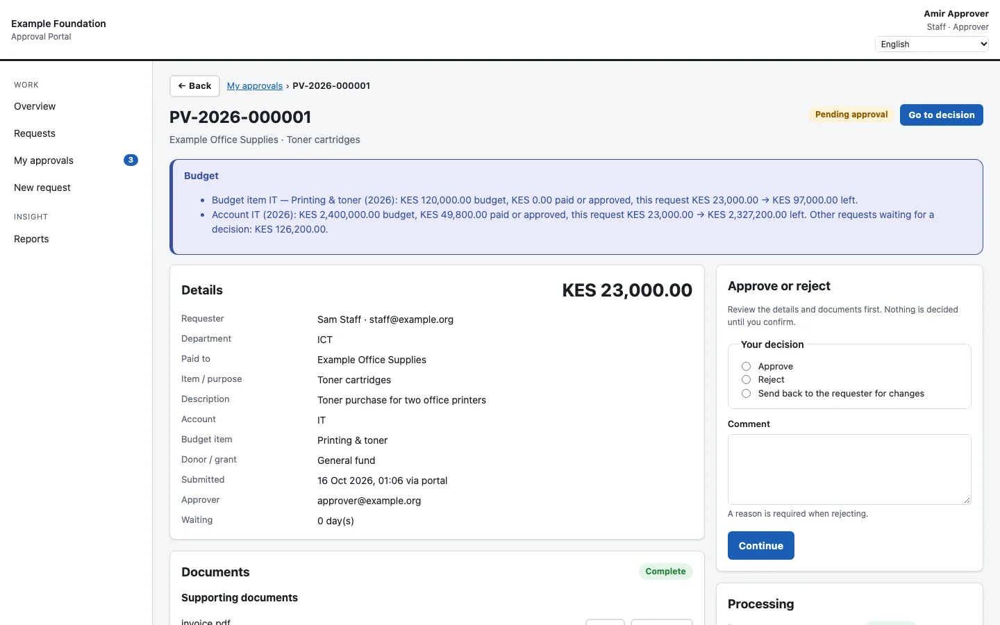
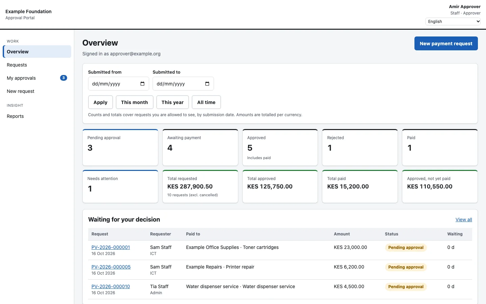
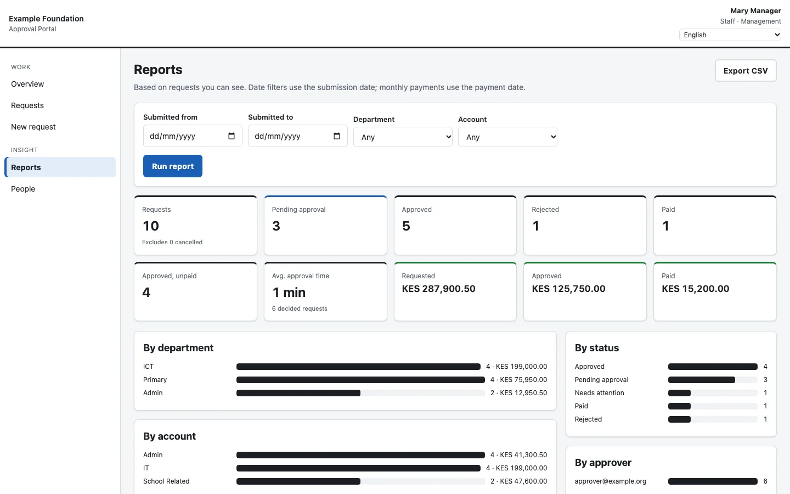

# Approval Portal

**Status:** version 0.1.0, pre-pilot · **Built with:** Google Apps Script, JavaScript, Google Workspace, automated tests

[← All case studies](../README.md)

## The problem

Payment approvals at a nonprofit ran through forms and email chains. Requests got lost between steps, nobody could see what was waiting on whom, and the audit trail was a pile of emails.

## What it does

- Staff raise payment requests with their documents attached.
- Approvers see a budget check, the documents and a single decision form: approve, reject or send back.
- Finance processes approved payments from a queue that does not lose requests.
- Management gets totals and breakdowns by department and status.
- Each organisation runs its own copy inside its own Google Workspace.

*Review: budget check, documents and the decision form.*

*Overview: counts, totals and requests waiting for a decision.*

*Reports for management.*

Screens come from a local preview that uses made-up data only.

## How it is built

- **Six roles:** staff, approver, finance, auditor, management and administrator.
- Every read and every action checks permissions on the server, not just in the browser.
- A durable processing queue carries each request through its steps.
- The audit log is protected by a hash chain, so any change to an earlier entry shows.
- Automated tests run the server code against simulated Google services.

## Where it stands

The server code, dashboard and documentation are complete, and the automated tests pass. Testing on a live Workspace installation is next.
