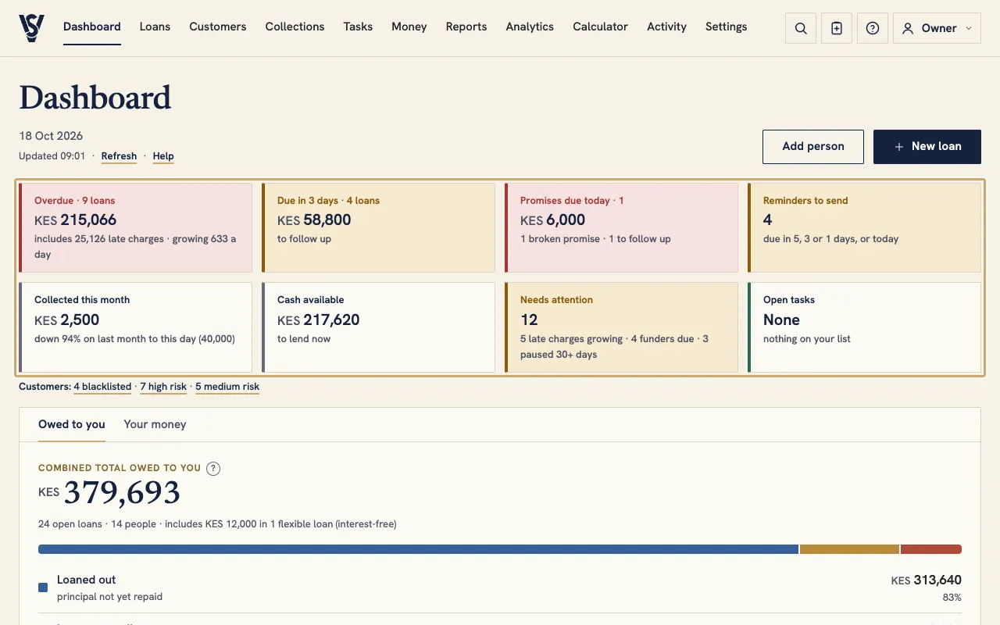
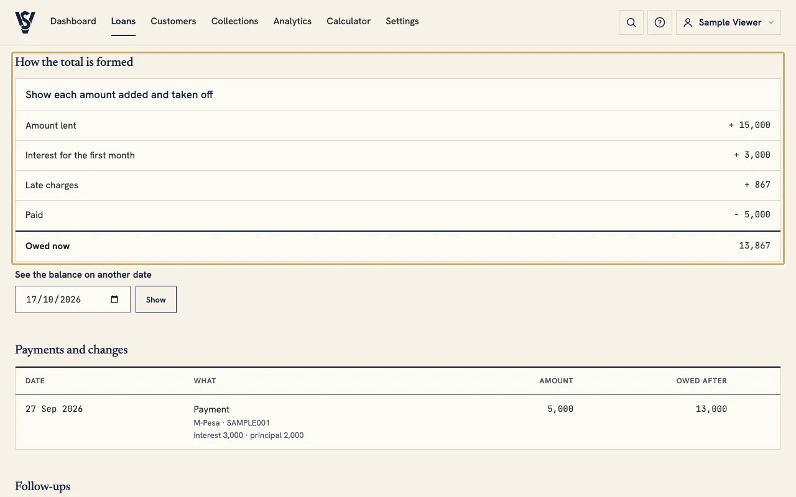
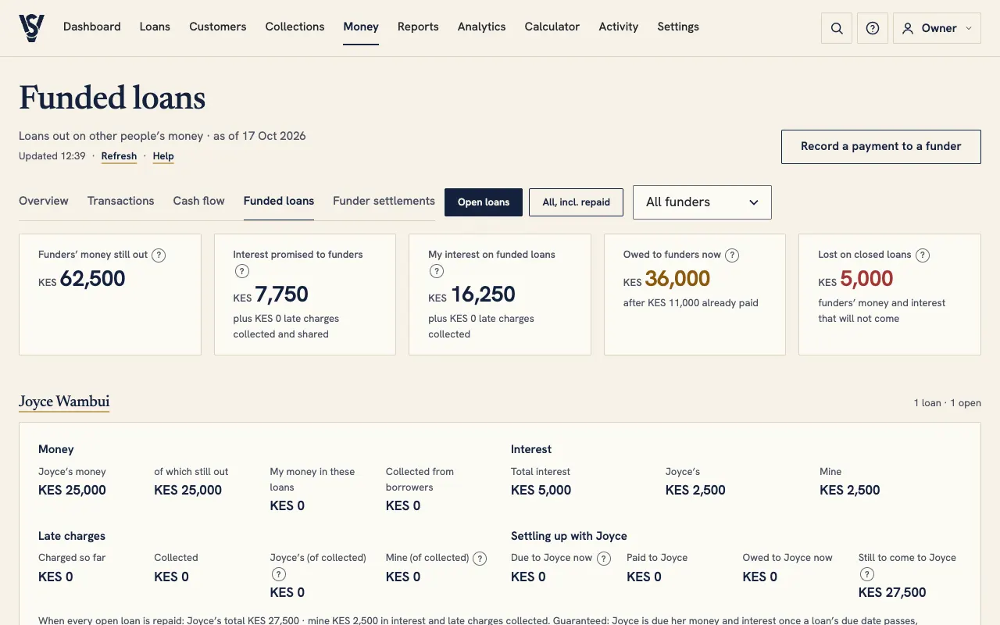
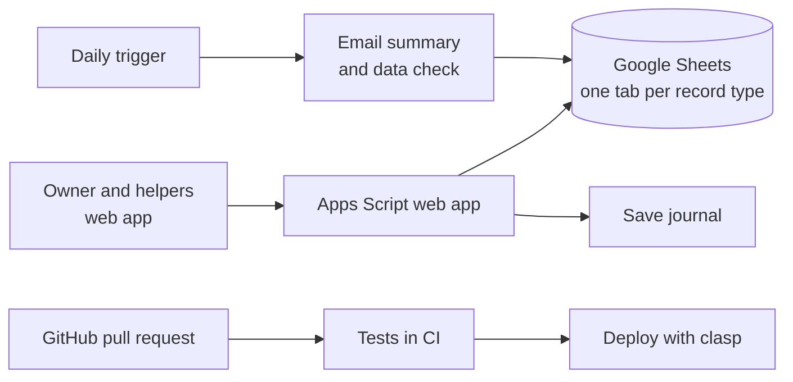

# Loan Portal

**Status:** live, in daily use · **Built with:** Google Apps Script, JavaScript, Node tests, GitHub Actions

[← All case studies](../README.md)

## The problem

Short-term lending to friends and family had outgrown a spreadsheet. Interest, late charges and extensions were worked out by hand. Loans partly funded by other people were hard to settle fairly, and nobody could say what had changed, when, or why.

## What it does

- Keeps the whole loan book: people, loans, payments, extensions and rollovers, write-offs and repayments in full.
- Works out interest and late charges by written rules, including late charges on interest where a loan allows it.
- Shows, line by line, how every balance was formed, and what a balance was on any past date.
- Handles **partly funded loans**: each funder's share of the money, interest and late charges, what is due to them and when, and a record of payouts.
- Sends a **daily email summary**: what is overdue, what is due soon, and any data that needs checking.
- Tracks personal **expenses imported from M-Pesa** messages, after each one is sorted on a shared desk.
- Gives each customer a page with only their own figures, under a random code rather than the loan number.

*The dashboard, on the local preview's made-up data.*

*Every balance shows each amount added and taken off.*

*Funded loans: each funder's money, interest and settlement.*

## How it is built

- A single Apps Script project serves the web app, stores data in Google Sheets and sends email from the owner's account.
- **Rules first:** more than 160 numbered decisions record each money rule before it is coded.
- **Tests:** over 930 automated tests run the real server code in Node, against in-memory fakes of the Google services.
- **Releases:** every change goes through a pull request. CI runs the tests, and merging deploys a new version automatically.

## How it is kept safe

- Every save is written to a journal first. A save that does not finish is flagged in the app and in the daily email.
- Roles limit what helpers and customers can see and do, and every change is logged with who made it.
- Live code is tagged before each change, so any release can be rolled back.
- A plain-language help guide with screenshots ships with the app and is rebuilt with every change.

## Where it stands

In daily use. 383 commits and 157 merged pull requests as of October 2026.
