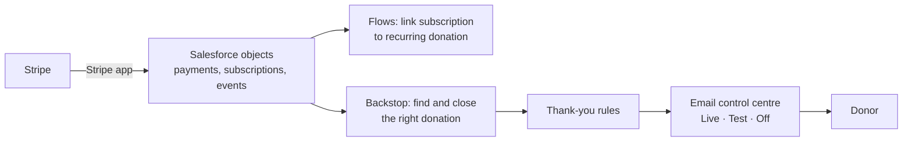

# Stripe and Salesforce (NPSP)

**Status:** built and tested in the Salesforce sandbox; not yet in production · **Built with:** Apex, Lightning Web Components, Salesforce Flow, Stripe, NPSP

[← All case studies](../README.md)

## The problem

A children's charity takes card donations through Stripe, including recurring sponsorships. Its donation records live in Salesforce (NPSP). Closing the right donation and sending the right thank-you depended on manual steps that could be missed, or done twice.

This is phase 0 of moving everything after checkout from a separate donation portal into Salesforce.

## What it does

- **Payment sync:** the Stripe app for Salesforce brings in payments, invoices, subscriptions and events. Flows link each Stripe subscription to its NPSP recurring donation, and each Stripe customer to the donor's account.
- **Reconciliation backstop:** when a payment succeeds, a record-triggered flow finds the matching donation. It tries the Stripe payment ID first, then the recurring donation through Stripe metadata, then the donor's email and amount. It closes the gift and creates a task to verify the match. Stamping the payment ID fixed a bug that closed two instalments for one payment.
- **Thank-you rules:** renewals trigger an automatic thank-you only when the gift is closed and won, the donor has an email address and is not deceased, and an amount is present. One-time, first and renewal payments are told apart, so no donor is emailed twice.
- **Email control centre:** an admin console built as a Lightning Web Component switches each of 13 email types between Live, Test and Off, and logs every change. Test mode builds the exact donor email but sends it only to admins. Templates can be overridden per campaign and per country, with a live preview, a work queue and one-click resend.

## How it is kept safe

- Each gift carries one of 8 statuses, from Sent to Failed, with a message saying what to fix.
- Failures and deceased-donor cases alert an admin. A daily scheduled flow flags Stripe events that have not synced.
- A missed thank-you resends automatically once the donor's email address is added.
- Access is split across 4 permission sets and a custom permission.

## Tests and delivery

- 26 of 26 Apex tests pass, with 89–92% coverage on the main classes. 11 of 11 Jest tests pass for the components.
- GitHub Actions does a full test deploy and runs every test on each pull request, then deploys to the sandbox on merge.
- About 77 metadata files: 9 flows, 5 Apex classes and their tests, 2 Lightning Web Components, 3 custom objects or settings, 4 permission sets.

## Where it stands

Built and tested in the sandbox. The pull request is open and nothing is in production yet.
