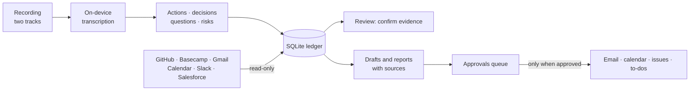

# WorkTrail

**From meeting promises to verified delivery.**

**Status:** working build, in active development · **Built with:** Python, FastAPI, SQLite, on-device transcription (MLX), Claude API

[← All case studies](../README.md)

## The problem

Technical meetings produce promises: "I'll fix that", "we'll go live Friday". Following up meant relying on memory. Monthly reports were written from recollection rather than evidence.

## What it does

- **Records** meetings without a bot joining the call. The user's microphone and the other participants' audio are captured as separate tracks.
- **Transcribes on the device,** offline, and labels lines as "Me" or "Others".
- **Pulls out** actions, decisions, questions and risks, each linked to the moment in the recording.
- **Looks for proof** that each item was done, in six work tools: GitHub, Basecamp, Gmail, Google Calendar, Slack and Salesforce. A person confirms each match before an action is marked "verified done".
- **Drafts** agendas, follow-ups and a monthly management report that cites its sources. Anything it cannot back up goes under "To confirm".
- **Asks before it acts.** Email drafts, calendar events, GitHub issues and Basecamp to-dos wait in an approvals queue. Nothing is sent on its own.
- **Watches Salesforce** for idle admin users, sign-ins from outside the organisation, overdue pledges and failing automations.
- **Works across two machines:** a link pulls in the work log from a second Mac running AI coding sessions.

## How it is kept safe

- Audio and video never leave the machine. Only text reaches the language model.
- Every connector only reads. Write-back happens only through the approvals queue.
- Every edit to an item is kept in its history, and every model call is logged with its cost.
- Text from emails, documents and chats is treated as data, never as instructions.

## Where it stands

A working build with its user, technical and migration guides. Connectors and the review flow are in place, and development continues.
